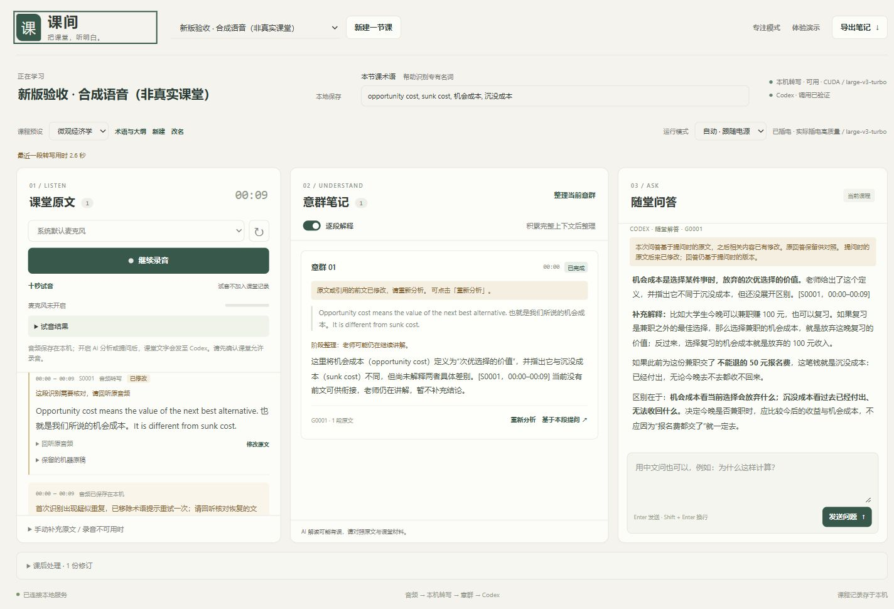

# 课间 · Classroom Assistant

面向 Windows 线下课堂的本地学习助手：用麦克风分段转写以英语为主、夹杂中文的讲课内容，再按意群解释，并支持随时打字提问。语音识别在本机运行，文字分析复用已登录的 Codex CLI。

这是可试用的个人项目。字幕按片段更新，不是逐字零延迟字幕；真实教室的识别效果和持续两小时的续航尚未验证。



预览使用合成示例，不是真实课堂记录。验证范围见 [验证记录](docs/VALIDATION.md)。

## 能做什么

- 中英混合转写、时间标记、原音频回听、低置信提示；可修改文字并保留机器原稿。
- 左侧原文、中间意群解释、右侧问答；支持专注模式、回看和回到实时。
- 自动 / 电池省电 / 插电高质量三种模式；显示实际模型、设备、处理队列与转写积压。
- 微积分、微观经济学课程预设，可新增、改名、补充大纲并通过 Codex 生成术语。
- 十秒试音、录音失败时手动补充原文、网络或 AI 失败后恢复；录音与 AI 队列分开处理。
- 课后手动高质量重转写，修订稿另存；JSON / Markdown 导出，也可只删除录音、保留文字。

## 安装

需要 Windows、Python **3.10 或更新版本**、新版 Edge 或 Chrome。前端无打包步骤；Node.js 仅用于下方的 JavaScript 测试。如果选择用 npm 安装 Codex，则该安装方式也需要 Node.js。

### 1. 创建运行环境

下载或克隆仓库，在项目目录打开 PowerShell，执行：

```powershell
powershell -ExecutionPolicy Bypass -File .\setup.ps1
```

脚本创建 `.venv`、安装 `requirements.txt`，并在没有 `config.json` 时从 `config.example.json` 复制一份。已有配置不会覆盖。脚本不会下载语音模型或配置 NVIDIA 运行库。

### 2. 准备本地语音模型

完整模式需要两个 **faster-whisper / CTranslate2 格式**的多语言模型，放到：

```text
models/
  faster-whisper-small/
  faster-whisper-large-v3-turbo/
```

兼容模型下载参考：

| 用途 | 模型仓库 |
| --- | --- |
| CPU 省电模式 | [Systran/faster-whisper-small](https://huggingface.co/Systran/faster-whisper-small) |
| GPU 高质量模式 | [mobiuslabsgmbh/faster-whisper-large-v3-turbo](https://huggingface.co/mobiuslabsgmbh/faster-whisper-large-v3-turbo) |

large 模型链接目前会跳转至 `dropbox-dash/faster-whisper-large-v3-turbo`。这些链接是兼容格式的下载参考，不构成本项目历史测试权重的来源校验。

下载模型仓库的完整实际文件，保留 `model.bin`、`config.json`、`tokenizer.json`、`vocabulary.json` 或 `vocabulary.txt`，以及仓库中的其他模型配套文件。不要只保存模型网页、下载指针或英文专用的 `.en` 模型。模型权重不包含在本仓库中。

默认配置使用上面的相对路径，也可修改 `config.json`：

```json
{
  "mode": "auto",
  "cpu_model_path": "models/faster-whisper-small",
  "gpu_model_path": "models/faster-whisper-large-v3-turbo"
}
```

只先准备 small 模型也可以试用 CPU 转写；GPU 功能需要完整大模型和可用的 NVIDIA 环境。

### 3. 可选：配置 NVIDIA GPU

高质量模式需要接通电源、可用 NVIDIA 独显，以及与 CTranslate2 匹配的 CUDA、cuBLAS、cuDNN 运行库。请按 [faster-whisper 官方 GPU 安装说明](https://github.com/SYSTRAN/faster-whisper#gpu) 配置，不要仅凭已安装显卡驱动判断依赖齐全。

如 DLL 不在当前环境可发现的位置，可在 `config.json` 的 `cuda_library_dirs` 中填写对应的本机目录。程序不会替你开启独显或修改系统电源设置。条件不足时，界面会说明 CPU 回退；模式切换在音频片段边界进行。

### 4. 安装并登录 Codex

按 [OpenAI Codex 官方安装说明](https://github.com/openai/codex#quickstart) 安装 CLI，确保 PowerShell 能执行 `codex`，然后运行：

```powershell
codex --version
codex login
codex login status
```

登录时使用自己的 ChatGPT 账号。账号是否可用、模型权限与额度由 Codex / ChatGPT 决定；本项目不提供额外额度，也不要求把 API Key 填入项目。

**CLI 兼容性：已测试版本为 `0.163.0-alpha.11.1`。** 桥接使用 `codex exec` 的较新选项，包括 `--ignore-user-config`、`--ignore-rules` 和 `--ephemeral`。其他版本需核对 `codex exec --help`，不能假定任意稳定版或旧版本都兼容。若出现“不认识参数”，先检查版本和 [桥接实现](codex_bridge.py)，不要直接删掉隔离选项。

## 上课时怎么用

1. 双击 `启动课间.vbs`，浏览器打开 [本机界面](http://127.0.0.1:8766)。也可用 PowerShell 执行 `./start.ps1`。
2. 新建一节课，选课程预设，检查运行模式和麦克风，先做一次**十秒试音**并回听。试音不加入课堂记录。
3. 确认课堂允许录音后，手动点击「开始录音」。需要时选择「逐段解释」或「只在提问时分析」，在右栏提问。
4. 结束时点击「暂停录音」，等待尾段上传及转写完成，再导出。AI 失败时可选择补分析或从最新内容继续。
5. 用完双击 `停止课间.vbs`。单独关闭网页不等于关闭后台服务。

首次模型加载、分片等待、队列和 Codex 调用都计入实际等待时间。出现积压时请看页面状态，不要把“已录到音频”理解成“已完成转写”。

## 数据与边界

录音、课堂原文、解释、问答和修订默认保存在本机 `data/`；未发送成功的录音片段暂存在当前浏览器的 IndexedDB。请在离开页面前处理待发送提示。服务默认只监听 `127.0.0.1`。

使用 AI 解释、问答或术语生成时，相关课堂原文、问题、术语或大纲**文字**会发送给 Codex；原始音频不发送给 Codex。登录由 Codex 管理。仓库不附带账号凭据、个人课程记录或模型权重；分享问题时也请先检查日志、导出文件和截图。

语音模型和 AI 都可能出错，尤其是远距离收音、中英切换、数字、否定词和公式。原文修改后，旧解释和问答会提示依据已变化；已有答案不会悄悄改写。当前不提供板书 / PPT 识别、说话人区分或语音提问。

## 开发检查

```powershell
.\.venv\Scripts\python.exe -m pip install -r requirements-dev.txt
.\.venv\Scripts\python.exe -m pytest tests -q
node tests/audio.cjs
node --check static/app.js
node --check static/pcm-worklet.js
```

这些自动化检查使用模拟组件或合成音频，不会开启真实麦克风，也不调用真实 Codex。性能数据、已知识别失败和未验证场景见 [docs/VALIDATION.md](docs/VALIDATION.md)。

## 许可

本仓库暂未指定许可证，公开代码不等于授予任意复制、修改或再分发许可。第三方依赖和模型分别适用其自身许可证。
