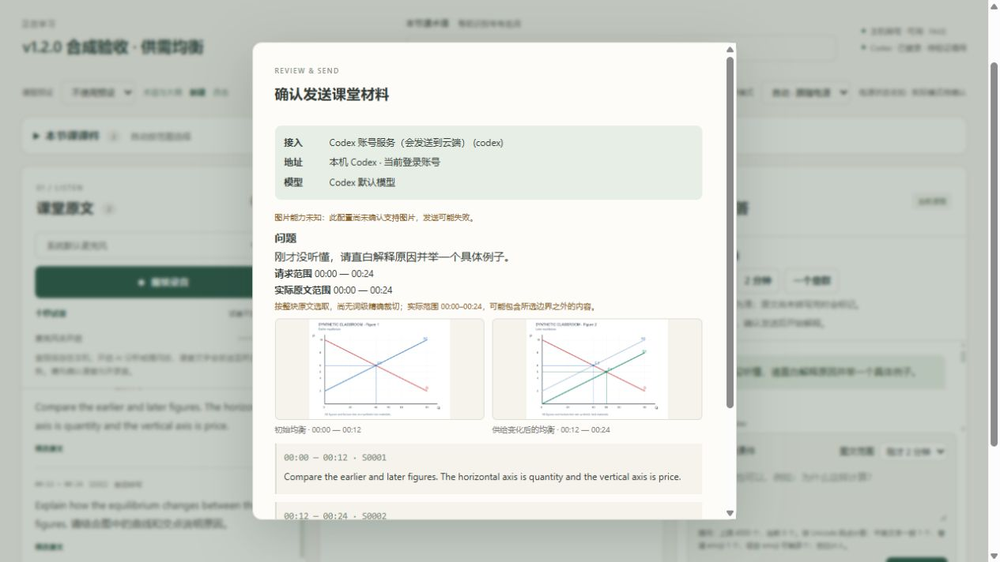

# 验证记录与已知边界

## v1.3.0 验证 · 2026-10-28

基线为已发布 v1.2.1 的 `df298390eb9024256dbd0da1548c99cadfef875e`，开发分支 `feature/v1.3.0`。用户确认的范围与实施记录见 [SCOPE](V1.3.0-SCOPE.md) / [PLAN](V1.3.0-PLAN.md)。收尾只读核对远程 main、v1.2.1 tag 的目标提交仍为该基线，最新 Release 为 v1.2.1，尚无 v1.3.0 tag。本轮只准备本地提交，没有 push、合并、tag 或 Release；正式安装及其 data/config/模型/环境保持原样。

### 先失败的回归与修复

- 新增结构化结果、AI 桥接、复习生命周期、portable package 和前端回归，先运行缺失功能/故障用例，再实现。桥接最初一次环境目录不存在不计为产品问题；创建隔离测试父目录后实际得到 9 项缺失方法失败。
- 结构化结果检验 Unicode 上限、实际来源、重复键、截断 JSON、缺失字段、英文开关及同源不同卡片；不能仅凭 cards 非空把没有笔记的结果标成完成。完整但非法的返回在业务层保留原始内容，避免传输层先丢弃并误判结果未知。`missing` 数组伪引用的两项回归也先失败再修复。
- 复习工作流覆盖标记/笔记版本冲突、冻结范围、重复任务、多批覆盖、实时问题插队、返回后存储故障、重启与强制换接入。修复写入回滚断开工作线程对象引用、未落盘产物提前可见、确认字符串被视为授权及未知 API 结果用量归类问题。
- 浏览器模拟回归复现并修复同课堂更换课程预设未更新英文默认、复制标签草稿身份冲突、并行收据覆盖、标记编辑期间轮询推进 revision 绕过冲突检查、不可用音频误显示入口；保存冲突保留用户输入。
- 导出恢复回归检验独立副本、历史图片、无音/有音、旧 JSON、丢响应去重、ZIP 路径/哈希/尺寸与原子写入。Windows 只读文件描述符 fsync 故障、Markdown 既有文案兼容，以及外部导入遗漏运行期必要字段/mime_type 均有回归证据后修复。
- 离线阅读器检查复现缺少过期/新增材料与批次失败提示、没有原文回跳、音频损坏后残留按钮空引用；新增 Node 回归后修复，并在导出时计算只读状态投影，冻结证据保持不变。

### 验证结果

- **Python 全套：525 passed、171 subtests passed，0 failed、0 skipped，67.57 秒。** 命令：`python -m pytest tests -q --basetemp ..\review-pytest-v130-final`，隔离合成目录，保留原有回归。包括真实 loopback HTTP 的标记/生成/编辑/导出/下载/导入/重启去重、旧结构载入、删除录音保留文字与复习记录、恢复副本隔离、真实合成密钥 Windows DPAPI。
- **Node 九套全部通过：** audio、ai-settings（28 次模拟请求）、input-limits（55 项，91 次模拟请求）、study-ui、study-cache、review-render（20 项）、review-ui、review-mount、portable-reader（18 项）。DOM/API 为合成替身；两个渲染套件加载真实本地 KaTeX。
- **静态检查通过：** Python compileall/py_compile、应用 JS 与 reader 语法、setup/start/stop PowerShell 解析、git diff --check。没有新增跳过或删除失败用例。早期全套出现旧 Markdown 两项契约失败，修复保留既有输出后通过；版本更新后 Node 的旧页脚断言失败，同步为 1.3.0 后九套通过。
- **阅读页实际浏览器验证：** 关闭应用后台后，只运行独立本机静态 HTTP 服务，打开解压的最终包；1000×680 合成图片实际解码、4 处 KaTeX 公式、中英/emoji、过期状态、失败批次、个人笔记及原稿保留通过。卡片依据跳到对应原文锚点；1 秒合成静音 WAV 从片段偏移播放到 ended，未使用真实录音或麦克风。用户 `<script>` 文字不形成脚本节点，控制台未记录错误/警告。
- **尚未完成的验收：直接 `file://` 双击。** 浏览器工具的 URL 安全策略明确拒绝该协议；未更换浏览器或绕过限制。静态 HTTP 结果不能证明浏览器在 file 协议下的 CSP/本地媒体行为。需用户在解压文件夹中双击 `index.html` 复验图片、公式、来源跳转与回听；此项仍是发布前人工门槛。

真实 Windows 浏览器验收使用 `tests/manual_browser.py` 的隔离 `127.0.0.1:8769` 服务，课堂、供需图、静音 WAV 与 AI/ASR 均为合成材料：

- 实际文件选择器上传图、修改关联时间、原文和图片标记、生成计划核对、四类卡片和双语内容、KaTeX 均衡条件显示、教师依据回看、原文回跳通过。
- 编辑个人笔记保存成功，中文/英文/emoji 与公式保留，`<script>` 显示为文字。修改原文后旧标记、卡片、笔记提示待核对；再次生成只增加新版，当前采用的手改笔记与原 AI 稿保留。后台重启和刷新后仍可恢复。
- 网页预检默认不带音频；勾选录音后文件数增加、显示预计大小，使用浏览器原生下载。刚下载的 ZIP 经网页预检与恢复得到独立课堂，原课堂保留；副本卡片的原音 URL 使用副本课堂 ID，个人编辑/采用版本仍在。
- 合成模型超时后显示“请求超时、无法确定服务商是否已处理”；只勾普通发送确认、未勾重复计费风险时不再发送，刷新后假调用次数仍为 1。另注入 send 已处理而响应丢失，刷新显示核对原请求，手动查询后新增假调用数为 0。非法 JSON 显示失败和“未自动重新请求”，不成为正式完成结果。

环境：Windows 10.0.26300，Python 3.10.4，FastAPI 0.161.1，Pydantic 2.14.1，httpx 0.28.1，pytest 9.1.1，Pillow 12.3.0，Node 24.19.0，PowerShell 7.6.5。公式使用随项目分发的 KaTeX 0.19.1，固定官方 npm 包 SHA512 与 MIT 许可证见 vendor README；没有 CDN 或 npm 生命周期脚本。

### 限制及升级回退

本轮不读取真实凭据、不上传课堂数据、不调用真实 Codex/收费 API、不打开麦克风；模型回答均为测试替身，不能证明模型理解、公式推导或事实正确。Windows DPAPI 使用合成密钥；PowerShell 仅解析，VBS/双击启停、真实 ASR 模型、CUDA、教室收音与续航未实际验证。

资源上限用合成小文件及缩小阈值验证拒绝逻辑，未实际构造/传输 2 GiB 大包，也未填满用户磁盘。磁盘故障、并发冲突和网络丢响应通过可控故障注入，不等同于断电测试。应用字符预算不是 token 保证；本机不静默重发不等于服务商只计费一次。公式不支持时保留源文提示。去重为规范化内容/来源指纹，不承诺跨表述语义去重。

升级前停止录音/后台并备份完整程序与 data；保留配置、模型、运行环境与历史图片。旧课堂缺失 review 时按空记录读取，不批量迁移；不兼容或损坏的可选复习块只读提示，原文继续可读。导入外部包另行严格校验并新建副本，原请求不会自动运行。回退用升级前程序和数据备份，升级后课堂另存，旧程序不能用于重试 v1.3.0 任务。课堂包默认不含录音且不包含配置/环境/未保存页面草稿，不代替完整应用备份。

## v1.2.1 验证 · 2026-10-28

开发基线是已发布 v1.2.0 的 `2c22e3d246c42b615e01184ac4f8ce55b91f2fdd`，工作分支 `bugfix/v1.2.1`。收尾只读核对远程 `main` 仍指向该提交、最新 Release 为 v1.2.0、远程 v1.2.1 tag 不存在。本轮准备本地提交，尚未推送、合并、建 tag 或 Release。正式安装及其 data/config/模型/运行环境未改动；本轮全部课堂材料为隔离合成数据。

### 复现与修复

| 范围 | 复现证据与严重程度 | 修复及主要文件 |
| --- | --- | --- |
| 重复请求、结果未知 | P1：同 ID 重复上传/prepare 原先创建第二条记录；发送响应丢失后刷新可能丢失原操作入口；旧恢复可再次处理未知结果。使用假模型与故障注入复现，不表示已证明服务商重复收费。 | 持久请求 ID + 内容指纹、后台查询、发送标记先落盘、浏览器未决操作记录、超时未知状态与重复计费确认。`app.py`、`study_workflow.py`、`classroom_features.py`、`ai_api.py`、`static/app.js`、`static/study-cache.js`。 |
| 切课隔离 | P2：A 问题草稿进入 B；A 原文编辑弹窗在 B 仍打开。延迟回调及导出额外覆盖点击课堂归属。 | 每课草稿、课堂 ID/视图代次检查；关闭旧弹窗、丢弃迟到显示；手动原文/设置/导出固定课堂。`static/app.js`、`app.py`。 |
| 图文修改与旧答案 | P2：prepare 后修改原文，send 或队列出队仍直接调用；关联变化缺少明确提示。 | 发送前和出队前核对来源状态；继续旧快照须再次确认；自然续讲不影响范围。历史按版本/hash 读取，损坏不替换。`study_workflow.py`、`slide_history.py`、`static/app.js`。 |
| 失败图片恢复 | P2：旧版本无 Blob 持久恢复，手动重加会取新时间；较早时间补传曾被拒绝。 | 10 张 / 100 MiB 原图暂存、明确降级、先查后传、原时间回填，人工区间不被覆盖。`static/study-cache.js`、`static/app.js`、`slide_context.py`。 |
| 方向、大小、移除 | 旧版本仅自动 EXIF 校正，无手动旋转/移除；大小错误缺少实际值。新增验收用例先失败。 | 保持 10 MiB / 2,400 万像素，显示实际值；90 度旋转不可变版本、软移除、旧图保留。`slide_context.py`、`slide_history.py`、前端三文件。 |
| 修复中的交叉检查 | P2：多标签初始化快照导致课堂清理漏项；未决请求被另一标签覆盖；普通问答的重试 ID 若永久复用会阻止下一次明确重试。 | 数据库事务内枚举、请求条件更新/删除、确认旧操作完成后释放客户端操作 ID；补先失败回归。 |

初始请求专项 10 项失败，普通问答补充 2 项失败；图片/history 首批 13 项失败，随后补充关联时间、回填和缓存故障用例；UI 草稿串课、未持久化图文发送、编辑弹窗残留分别先失败。缓存新增模块最初无法加载，后续多标签旧快照及降级删除故障也先失败。以上均已修复。

### 最终结果

- **Python 全套：403 passed、171 subtests passed，0 failed、0 skipped，49.85 秒。** 命令：`python -m pytest tests -q --basetemp <隔离目录>`。保留 v1.2.0 的 356 项基线，新增 47 项。
- **Node 五套通过并输出完成摘要：** `audio.cjs`、`ai-settings.cjs`（28 次模拟请求）、`input-limits.cjs`（55 项、91 次模拟请求）、`study-ui.cjs`、`study-cache.cjs`。覆盖 Unicode 边界、录音分段、AI 设置、材料冻结、来源确认、收费请求恢复、跨课、旧图版本、浏览器存储限额和多标签冲突；未开启真实音频设备。输入与 study UI 套件增加未完成退出保护，避免未解决 Promise 导致退出码 0 被误判为通过。
- **真实回环 HTTP：** `test_v121_acceptance.py` 通过真实 TCP 串联两课、上传/prepare 重复、查回原请求、旋转版本、拒绝旧确认、确认旧快照、同任务重复 send 仅一次假模型调用、移除/编辑/导出、重启恢复，以及历史文件损坏明确不可用。另保留旧 HTTP 回归。
- **真实 Windows 浏览器：** 在独立 `127.0.0.1:8768` 使用文件选择器和剪贴板上传合成供需图。上传故障后刷新、两课切换、草稿恢复、从原 24 秒手动补传（老师已续讲至 30 秒）、旋转预览/保存、软移除、旧图 v1 的 1100×780 像素加载、改字前后依据对照均通过。后台重启恢复记录，仍遵循最新创建课堂规则。
- **真实浏览器请求保护：** 注入 send 已入队但 HTTP 响应丢失；刷新后保留核对入口，再点击提交先阻止新请求，手动核对只读取原任务，假模型调用次数保持 1。另注入假模型超时，页面显示指定文案；再次请求的重复计费复选框未勾选时发送不可用，没有实际再次调用。
- **真实 IndexedDB：** 刷新、关闭页面再打开，两个课堂 Blob/时间/中英 emoji 草稿恢复；两个标签同时竞争同课堂不同请求 ID，一方成功，另一方明确拒绝覆盖。容量不足、权限禁用和写入失败使用测试替身注入，未填满用户磁盘或真实浏览器配额。未退出整个浏览器进程测试。
- **静态检查：** Python compileall、`app.js` / `study-cache.js` / `pcm-worklet.js` / 浏览器验收脚本的 Node 语法、setup/start/stop 三个 PowerShell 文件解析、`git diff --check` 通过。LF/CRLF 规范提示不是检查失败。

开发中第一轮全套为 401 passed / 2 failed：旧 RuntimeError 重试测试未包含结果未知确认。现保留“只一条记录、旧 job 报错、新 job 完成”的断言，增加未确认返回 409、不多一次调用，再明确确认重试。Node 旧页脚版本断言更新为 1.2.1；输入测试补充状态查询 mock、各边界用例独立请求状态及视图代次，全部 55 项仍通过。没有删除失败用例或增加跳过。

环境：Windows 10.0.26300，Python 3.10.4，FastAPI 0.161.1，Pydantic 2.14.1，httpx 0.28.1，pytest 9.1.1，Pillow 12.3.0，Node 24.19.0，PowerShell 7.6.5。全套包含使用合成密钥的真实 Windows DPAPI 检查，没有读取真实凭据。

### 手工复验与边界

可用 `python tests/manual_browser.py --data-dir <新建隔离目录> --port 8768` 启动纯假 AI/ASR 的手工验收服务；它拒绝复用非验收目录，禁止配置真实服务商和测试真实连接。`/acceptance/cache` 提供本机存储/多标签合成测试；失败开关和状态查询见该脚本说明。生产启动不提供这些测试路由。不要将验收目录指向正式 `data/`。

本轮没有真实模型/收费 API、麦克风、ASR 模型、CUDA、长时续航或真实教室测试；PowerShell/VBS 只做前者的语法解析，未双击启停验收。没有测试真实服务商超时计费、远端查询或取消能力。代码只能保证本机不静默重发，不能保证服务商恰好处理/计费一次。图片校验成功只说明本机文件符合要求，不代表模型理解正确。

浏览器暂存依赖同一地址/端口和浏览器配置；清理站点数据会丢弃本机待处理图片与草稿，存储降级时仅当前页保留。旧答案图像副本会占用磁盘；本版无永久清除历史图片或媒体 ZIP 导出。已有意群/词表等旧操作仍有各自显式重试入口，本版不增加整份课件导入或复习功能。

升级/回退按 README 执行：保留 data/config/模型/环境和完整 slides 文件夹，旧记录无须批量迁移；回退使用升级前备份，另存新版记录，旧版不能用于重试新版请求。发布须确认远程仓库、目标分支、版本/tag 和已验收提交后进行。

## v1.2.0 验证 · 2026-10-27

本次开发基于已发布 v1.1.1 的 `ba117d9d76af1652c52f2115113a1672de446a94`，分支为 `feature/v1.2.0`。收尾时远程 main 仍为该基线，最新 Release 为 v1.1.1，v1.2.0 tag 尚不存在。本文记录本地验收，不表示已发布；须用户确认后才推送验收的同一提交。现有正式安装仍为 v1.1.0，本轮未覆盖安装、数据、配置、模型或运行环境。

### 结果与复现证据

- **Python 全套：356 passed、171 subtests passed，0 failed、0 skipped，45.26 秒。** v1.1.1 历史基线为 248 项/124 子测试；保留旧用例，接入切换测试按已确认的新行为先验证普通切换 409，再验证强制切换和原有隔离断言；版本断言同步为 1.2.0。
- **Node：**音频连续重采样/分段、AI 设置（28 次模拟请求）、输入边界（55 项、83 次模拟请求）、新增 study-ui 全部通过。覆盖上传/粘贴、双图/多图选择、超限不丢图、发送确认、失败保留输入、显式纯文字、配置忙时拦截、强制切换后重新确认、点击期间延迟响应及材料版本冻结。使用合成 DOM/API，未开麦。
- **先失败后修复：**新工作流最初 11 项失败；点击冻结新增 2 项失败，前端延迟保存用例也先失败；跨课堂取消时第一节课保存失败、意群续写覆盖 partial、普通文本假编号被引用、工作线程启动/结束保存失败均有独立故障注入回归。修复后全部通过。
- **开发中的失败：**旧测试两处仍按旧规则直接切换，现已加普通切换拒绝与强制路径断言；一次 121 段音频重启测试在并发负载下超过原 12 秒等待，未放宽超时，顺序重跑及最终整套通过。版本升级后一处 Node 页脚断言仍为 1.1.1，更新为 1.2.0 后通过。未删测试或增加跳过。

### 实际验证与模拟边界

| 类型 | 实际执行与结果 |
| --- | --- |
| 环境 | Windows build 26300，Python 3.10.4，FastAPI 0.161.1，Pydantic 2.14.1，httpx 0.28.1，pytest 9.1.1，Pillow 12.3.0，Node 24.19.0，PowerShell 7.6.5。 |
| 真实 Codex 双图请求 | CLI `0.164.0-alpha.11.1`，只发送两张合成供需图和合成中英讲解；授权上限三次，实际一次。19.44 秒完成，读出先后均衡 Q40/P6 → Q50/P5，解释供给右移、需求不变，标注补充例子，引用两张图和两段原文。不是通用准确率或延迟保证。 |
| 真实回环 HTTP | Uvicorn 随机本机端口，通过真实 TCP 上传两图、准备快照、拒绝未同意发送、确认回答、导出、重启与图片恢复。验证跨课堂拒绝、非法图片、超长问题等。AI/ASR 为假组件。 |
| 真实浏览器 | 隔离 `127.0.0.1:8767`：文件选择器上传第一图、剪贴板粘贴第二图、编辑标题和 0–12/12–24 秒关联、30 秒解释、双图发送确认、回答依据展开；后台重启/网页刷新后图片、答案与证据保留。最新 seen_* 请求正常经过 HTTP 校验。该浏览器答案明确标为合成服务演示，未调用真实 AI。 |
| 真实 Windows DPAPI | 整套含临时合成密钥加密、解密、损坏与删除，未读取真实凭据。Windows 本轮没有 Linux 的三项跳过。 |
| API 模拟 | MockTransport 验证图片数据内容、流式草稿、用量、明确不支持图片、一般错误区分、取消、无自动重发和来源校验。未使用真实第三方 API，也未产生收费 API 请求。 |
| 静态检查 | Python compileall、app.js/pcm-worklet.js 语法、setup/start/stop 三份 PowerShell 解析、git diff --check 通过。换行规范提示不构成语法或差异检查失败。 |

浏览器还验证了改字后保留机器原稿、旧答案过期提示及原证据不变；控制台未记录错误。1280×720 短屏曾被新增控件挤压答案区，已仅调整桌面三栏的最小高度，实测回答区 323 像素、页脚不重叠，证据可滚动回看。最终保存的真实 Codex 回答已通过最终版本的来源编号校验，未为界面或故障处理修改追加真实调用。



### 兼容性与剩余边界

课件每张最多 10 MiB、2,400 万像素，PNG/JPEG/WebP；不支持动画、整份 PPT/PDF 导入或自动抓屏。图片保存时应用 EXIF 方向并去掉元数据，按 SHA256 验证不可变文件。单次最多四图，不扩大既有文字上下文；文字过大时明确拒绝，不截断。

原文按整段选取，没有词级准确裁切；手动文字时间为估算。不能从没有待转写任务推断老师已讲完，快照显示所选范围和实际范围；尚无原文时等待，后续补齐须新建解释。引用编号校验只能证明编号属于实际材料，不能证明答案推理正确。

图片能力状态按当前配置和图片数量记录；成功不等于理解正确，服务商明确拒绝时不会静默转纯文字。强制切换尽力取消但不能保证远端撤回或免计费。后台重启后重新确认发图，已完成历史答案保留；JSON/Markdown 不含图片本体，必须连同课堂 `slides/` 目录备份。

若保存失败，AI 暂停并显示尚未保存提示；内存中的新答案不能保证跨进程崩溃或断电保存。磁盘恢复后显式恢复会保存已完成答案，不重复发出已完成请求。不要在故障未解决时退出后台。

本轮未实际验证真实麦克风、真实 ASR/CUDA、教室收音、续航、PowerShell 启停功能和 VBS 双击。第三方 API 图片兼容性也未实测。历史实测保留在下方，不作为本版本重新实测。升级/回退见 README；v1.1.x 不理解图文发送确认，不应重试新版图文记录。

## v1.1.1 补丁验证 · 2026-10-24

检查起点：本地与远程 main 均为 `dd07f9b47bebd6acae6698ff31c5474a274691c7`（v1.1.0），工作区无未提交修改，最新 Release 为 v1.1.0。修复在本地 `bugfix/v1.1.1` 分支进行。本文是发布前的验证记录，不表示已推送或发布；实际发布状态以 GitHub Release 为准，验收后仅发布同一提交。

### 已复现的问题与修复前失败测试

| 问题 | 严重程度及复现 | 修复与回归 |
| --- | --- | --- |
| 输入上限与提示不一致 | P2：手动／编辑框 30,000 对后端 12,000；提问 10,000 对 4,000；大纲 20,000 对 12,000。接口超限返回通用 422；浏览器原生 maxlength 使用 UTF-16 口径。 | `input_limits.py` 为后端与网页提供统一上限；显示字段、上限和实际码点数。直接 HTTP 和 Node 边界测试先失败后通过。 |
| 纯空白必填内容进入后端 | P2：空白问题进入 AI 队列，手动空白原文被当成成功但没有记录，编辑端另返 400。 | 必填文字统一返回明确的 422，不写入记录或入队；大纲仍可留空。 |
| 发送等待时新输入被清空 | P2：原文／问题发送后继续编辑，上一笔成功响应会无条件清空新草稿。 | 只有输入仍等于刚发送的文本才清空；两条延迟响应模拟用例在旧版失败、修复后通过。 |
| 同秒创建后的默认选择 | P2：冻结时间、指定逆序 UUID，演示／普通课堂互换创建顺序后重启可选中较早课堂。不是数据丢失。 | 新建记录增加创建序号，启动与列表共用排序；11 项覆盖重启后继续创建、五次切换、旧记录、混合新旧记录及缺失文件回退。 |
| 暂停词表不能恢复 | P2：暂停时提交词表，重启后被改成 error，点击补分析仍无任务。 | 保留 paused，由用户显式恢复；跨课堂仍归属原请求课堂。pending／running 中断不自动重发。 |
| 过期问答进入新上下文 | P2：把 ninety 修正为 nineteen 后，旧回答仍以 assistant 历史交给下一问。 | 过滤新问题历史中的 stale 问答；保留原问答和重试快照。不声称模型必然因此答错。 |

首轮新增后端输入用例修复前 **30 失败 / 40 通过**；课堂排序 **7 失败 / 4 通过**；相邻流程 **2 失败 / 2 通过**。均先保存失败结果再修复产品代码，未删除、跳过失败或弱化断言。

### 本轮验证结果

- 环境：Windows build 26300，Python 3.10.4，FastAPI 0.161.1，Pydantic 2.14.1，httpx 0.28.1，pytest 9.1.1，Node.js 24.19.0，PowerShell 7.6.5。
- 原 v1.1.0 产品源码基线：**160 passed、124 subtests passed**；最终整套：**248 passed、124 subtests passed，0 failed、0 skipped**。比基线新增 88 项，没有修改旧测试的行为断言；版本断言同步到 1.1.1。
- 输入覆盖：上限前一位、恰好上限、超限一位，空字符串、仅空白、空白计入长度、中英混合、普通／组合 emoji、组合附加符号，以及绕过前端直接提交。70 项接口测试全部通过。
- Node：输入边界、服务端元数据、离线、草稿保留 **55 项检查通过（83 次模拟请求）**；同一最终套件在只读 `dd07f9b` 源码上为 13 通过 / 42 失败。AI 设置原 28 次模拟请求通过，原 UI 生命周期 27 次模拟请求通过（仅补齐模拟状态中的输入上限元数据）；音频重采样／分段检查通过。所有模型调用和音频设备均为模拟。
- **真实 HTTP**：`tests/test_http_regression.py` 用 Uvicorn 监听随机回环端口、httpx 真正发送请求，完成超限、边界 emoji、编辑、两种导出、刷新与服务重启恢复。ASR 和 AI 使用假组件，未连接服务商。
- **真实浏览器 UI，模拟服务组件**：隔离地址 `127.0.0.1:8767`，四个入口超限时显示正确计数并保留输入；恰好 12,000 码点的中英／emoji 大纲可提交，正常混合语言提问、原文修正及过期提示正常。未提交文字留在当前页面，刷新并不承诺保留草稿。
- **真实 Windows DPAPI**：全套测试包含临时合成密钥的加密、解密、损坏检测和删除，不读取用户真实密钥。Linux 历史 3 项跳过不能套用到本次 Windows 结果。
- **静态检查**：Python 编译、JavaScript 语法、setup/start/stop 三份 PowerShell 解析，以及 `git diff --check` 通过。PowerShell 启停功能与 VBS 双击启动本轮未执行，不能据语法检查宣称端到端通过。
- **本轮未验证**：真实麦克风、真实 ASR 模型、CUDA 推理、真实 Codex／第三方 API、真实教室与续航。下方旧版本实测属于历史记录，不是本补丁重新实测。

### 兼容性与剩余边界

后台重启仍选“最新创建课堂”；手动切换不改变创建顺序。旧同秒记录没有足够信息重建真实先后，采用旧版启动的 ID 升序回退。项目没有删除整节课堂的 API；本轮“删除当前后的选择”仅在合成目录移除文件后验证重启回退，没有新增删除功能。旧版已经保存为 error 的词表任务不能猜测原暂停状态，仍需手动重新生成。

升级不批量回写历史课堂，不动模型和运行环境。本轮未升级正式安装或接触真实课堂目录。升级前暂停录音、等待队列结束、停止后台并备份，保留 `data/`、`config.json`、模型、`.venv/`；回退前另存升级后新增记录，详见 README。发布需先确认仓库、目标分支、版本、tag 与验收提交，之后仅发布该提交。

## v1.1.0 发布验证 · 2026-10-24

- 全套 Python 回归：**160 项测试、124 个子测试通过**。覆盖 Chat Completions SSE / JSON、流式中断与输出校验、HTTP 错误分类、缺失用量、无自动重试与重定向、Codex 环境隔离、实际 Windows DPAPI 合成密钥往返、保存失败回滚、接入切换、队列暂停、API 默认关闭自动分析、旧数据兼容及中断费用未知状态。
- 网页 AI 设置模拟测试：28 次请求通过；原 UI 生命周期回归的 27 次模拟请求通过。Node 音频连续重采样与分段检查、JavaScript 语法检查、PowerShell 启动脚本语法检查通过。
- 实际浏览器在隔离的本机服务中完成配置填写、测试连接、保存、清空密码显示、API 提问、正式结果与用量展示。使用合成课堂、合成密钥、MockTransport，不读取真实课堂，也不发收费 API 请求。
- 发布时未配置真实第三方 API 密钥，因此没有验证某一家真实服务商、真实模型的稳定性、速度或账单。需要使用者在网页填入自己的设置并执行测试连接。
- API 调用次数是持久记录的尝试次数；进程中断时可能无法知道服务商是否已经计费，单列为结果未知。token 只统计实际返回的数据；它不是账单或金额预算。


## v1.0.0 历史验证

验证日期：2026-10-23。下列性能来自一台 Windows 笔记本上的合成语音测试，不是通用性能保证，也不代表真实课堂识别准确率。[界面预览](preview.jpg)同样使用合成课堂示例。

## 自动化与界面检查

- Python 发布副本整套回归：**100 项测试及 13 个子测试通过**。覆盖录音接收、幂等与恢复、课程隔离、ASR 输入校验、模式切换、模型释放、AI 故障分类、编辑留痕、独立修订、音频删除，以及发布配置与路径可移植性。
- Node 音频检查：48 kHz / 44.1 kHz 跨 128 帧连续重采样、静音不上传、停止时短尾保留、最长 12 秒分片、连续时间轴及 16 kHz 单声道 PCM WAV。
- 开发阶段还完成 27 次模拟 UI/API 请求，覆盖新增控制和十秒试音生命周期；试音自动停麦、关闭音频上下文，不进入课堂上传队列或推进课堂时钟。
- 实际浏览器检查覆盖模式切换提示、课程词表、编辑与机器稿保留、解释 / 问答过期提示、专注模式和导出。

上述自动化检查不打开真实麦克风，不调用真实 AI。真实语音模型与 Codex 联调另列在下方；后续修改应重新运行回归，不沿用本次数目。

## 语音模型实测

测试使用 faster-whisper 1.2.1、CTranslate2 4.8.3；CPU small 使用 int8、6 个线程、beam size 1，GPU large-v3-turbo 使用 float16、beam size 1。GPU 为 NVIDIA GeForce RTX 5060 Laptop GPU。除特别说明外，下表是模型加载后的单次推理耗时，不含浏览器分片等待和其他队列。

| 合成音频 | 时长 | CPU small | GPU large-v3-turbo | 结果 |
| --- | ---: | ---: | ---: | --- |
| 英语 → 中文短句 → 英语 | 9.47 秒 | 3.14 秒 | 首次 CUDA 推理 6.27 秒 | 保留中英文，标点有差异 |
| 纯英语 | 10.49 秒 | 3.12 秒 | 1.01 秒 | 文字与合成原句一致 |
| 纯中文 | 11.57 秒 | 3.26 秒 | 1.09 秒 | 文字一致，标点有差异 |
| 英语 → 一整段中文，压力样本 | 22.31 秒 | 4.93 秒 | 1.20 秒 | small 把后半中文译成英文；large 保留原语言 |

22.31 秒样本绕过了浏览器的 12 秒分片上限，是直接 ASR 压力测试。它暴露了小模型的中英混合失败，不能因为短样本通过就宣称任意中英切换都准确。

首次 CPU 加载约 1.42 秒；CPU → GPU 切换与加载约 4.42 秒；GPU → CPU 约 1.17 秒。第一次 GPU 推理还包含运行库预热，因此后续约 1 秒的结果不能用于承诺冷启动速度。

## 带术语提示的重复识别

真实模型联调发现：一份较长的课程术语提示会诱发 large 模型输出重复内容，而且模型自身置信度仍可能较高。重复过滤成功拦截了这次结果。

当前处理方式是：仅当有术语提示且检测到重复时，无提示重试一次；第二次结果仍经过过滤，并保留警告与待核对标记。两次 GPU 恢复测试分别用时 **2.780 秒、2.445 秒**。同词表的 CPU 测试正常。这是对已观察问题的回退处理，不保证能发现所有幻觉或错误。

## 真实组件联调

用 9.47 秒的合成英 → 中 → 英音频，通过实际 HTTP 上传、本机语音模型、真实 Codex 登录、意群解释、提问和导出完成联调：

| 阶段 | 当次耗时 |
| --- | ---: |
| 独立试音转写，含冷加载 | 5.548 秒 |
| 课堂片段转写 | 2.47 秒 |
| Codex 意群解释 | 13.45 秒 |
| Codex 问答 | 12.81 秒 |

高质量修订稿独立保存，课堂原版未被覆盖；Markdown 导出包含修订。Codex CLI 当时版本为 `0.163.0-alpha.11.1`，调用耗时和可用性会随网络、账号额度与服务状态变化。曾有一次早期问答失败后重试成功，原因未能复现，未将其归因于确定的网络故障。

这些数字分别描述各阶段，不能相加成通用延迟，也不能当作持续运行的稳定速度。

## 尚未验证

- 70～80 人教室、座位不固定、教师是否扩音未知时的远距离收音。
- 多人同时说话、回声、噪声、复杂公式和连续的专业术语。
- 连续两小时录音、实际电池续航与长时间发热。
- 固定的字幕或解释延迟；分片等待、首次加载、积压和 AI 调用都会增加等待时间。

音量正常不代表话语清晰；低置信提示也不能发现所有错误。首次在真实课堂使用前，应先做十秒试音并回听，确认实际设备上的中英文转写表现。

## 复跑自动化检查

在仓库根目录、已创建的 Python 环境中执行：

```powershell
.\.venv\Scripts\python.exe -m pip install -r requirements-dev.txt
.\.venv\Scripts\python.exe -m pytest tests -q
node tests/audio.cjs
node tests/ai-settings.cjs
node tests/input-limits.cjs
node tests/study-ui.cjs
node --check static/app.js
node --check static/pcm-worklet.js
```

模型权重、合成测试音频、个人课程与原始本机诊断日志不随公开仓库分发。重新测性能需要自行准备合法音频、模型与账号，并记录硬件、模型、冷 / 热启动条件和完整结果。
