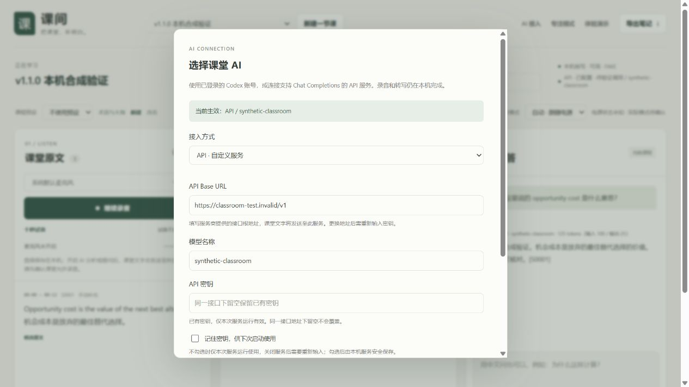

# 验证记录与已知边界

## v1.1.0 发布验证 · 2026-10-24

- 全套 Python 回归：**160 项测试、124 个子测试通过**。覆盖 Chat Completions SSE / JSON、流式中断与输出校验、HTTP 错误分类、缺失用量、无自动重试与重定向、Codex 环境隔离、实际 Windows DPAPI 合成密钥往返、保存失败回滚、接入切换、队列暂停、API 默认关闭自动分析、旧数据兼容及中断费用未知状态。
- 网页 AI 设置模拟测试：28 次请求通过；原 UI 生命周期回归的 27 次模拟请求通过。Node 音频连续重采样与分段检查、JavaScript 语法检查、PowerShell 启动脚本语法检查通过。
- 实际浏览器在隔离的本机服务中完成配置填写、测试连接、保存、清空密码显示、API 提问、正式结果与用量展示。使用合成课堂、合成密钥、MockTransport，不读取真实课堂，也不发收费 API 请求。
- 发布时未配置真实第三方 API 密钥，因此没有验证某一家真实服务商、真实模型的稳定性、速度或账单。需要使用者在网页填入自己的设置并执行测试连接。
- API 调用次数是持久记录的尝试次数；进程中断时可能无法知道服务商是否已经计费，单列为结果未知。token 只统计实际返回的数据；它不是账单或金额预算。



## v1.0.0 历史验证

验证日期：2026-10-23。下列性能来自一台 Windows 笔记本上的合成语音测试，不是通用性能保证，也不代表真实课堂识别准确率。[界面预览](preview.jpg)同样使用合成课堂示例。

## 自动化与界面检查

- Python 发布副本整套回归：**100 项测试及 13 个子测试通过**。覆盖录音接收、幂等与恢复、课程隔离、ASR 输入校验、模式切换、模型释放、AI 故障分类、编辑留痕、独立修订、音频删除，以及发布配置与路径可移植性。
- Node 音频检查：48 kHz / 44.1 kHz 跨 128 帧连续重采样、静音不上传、停止时短尾保留、最长 12 秒分片、连续时间轴及 16 kHz 单声道 PCM WAV。
- 开发阶段还完成 27 次模拟 UI/API 请求，覆盖新增控制和十秒试音生命周期；试音自动停麦、关闭音频上下文，不进入课堂上传队列或推进课堂时钟。
- 实际浏览器检查覆盖模式切换提示、课程词表、编辑与机器稿保留、解释 / 问答过期提示、专注模式和导出。

上述自动化检查不打开真实麦克风，不调用真实 AI。真实语音模型与 Codex 联调另列在下方；后续修改应重新运行回归，不沿用本次数目。

## 语音模型实测

测试使用 faster-whisper 1.2.1、CTranslate2 4.8.3；CPU small 使用 int8、6 个线程、beam size 1，GPU large-v3-turbo 使用 float16、beam size 1。GPU 为 NVIDIA GeForce RTX 5060 Laptop GPU。除特别说明外，下表是模型加载后的单次推理耗时，不含浏览器分片等待和其他队列。

| 合成音频 | 时长 | CPU small | GPU large-v3-turbo | 结果 |
| --- | ---: | ---: | ---: | --- |
| 英语 → 中文短句 → 英语 | 9.47 秒 | 3.14 秒 | 首次 CUDA 推理 6.27 秒 | 保留中英文，标点有差异 |
| 纯英语 | 10.49 秒 | 3.12 秒 | 1.01 秒 | 文字与合成原句一致 |
| 纯中文 | 11.57 秒 | 3.26 秒 | 1.09 秒 | 文字一致，标点有差异 |
| 英语 → 一整段中文，压力样本 | 22.31 秒 | 4.93 秒 | 1.20 秒 | small 把后半中文译成英文；large 保留原语言 |

22.31 秒样本绕过了浏览器的 12 秒分片上限，是直接 ASR 压力测试。它暴露了小模型的中英混合失败，不能因为短样本通过就宣称任意中英切换都准确。

首次 CPU 加载约 1.42 秒；CPU → GPU 切换与加载约 4.42 秒；GPU → CPU 约 1.17 秒。第一次 GPU 推理还包含运行库预热，因此后续约 1 秒的结果不能用于承诺冷启动速度。

## 带术语提示的重复识别

真实模型联调发现：一份较长的课程术语提示会诱发 large 模型输出重复内容，而且模型自身置信度仍可能较高。重复过滤成功拦截了这次结果。

当前处理方式是：仅当有术语提示且检测到重复时，无提示重试一次；第二次结果仍经过过滤，并保留警告与待核对标记。两次 GPU 恢复测试分别用时 **2.780 秒、2.445 秒**。同词表的 CPU 测试正常。这是对已观察问题的回退处理，不保证能发现所有幻觉或错误。

## 真实组件联调

用 9.47 秒的合成英 → 中 → 英音频，通过实际 HTTP 上传、本机语音模型、真实 Codex 登录、意群解释、提问和导出完成联调：

| 阶段 | 当次耗时 |
| --- | ---: |
| 独立试音转写，含冷加载 | 5.548 秒 |
| 课堂片段转写 | 2.47 秒 |
| Codex 意群解释 | 13.45 秒 |
| Codex 问答 | 12.81 秒 |

高质量修订稿独立保存，课堂原版未被覆盖；Markdown 导出包含修订。Codex CLI 当时版本为 `0.163.0-alpha.11.1`，调用耗时和可用性会随网络、账号额度与服务状态变化。曾有一次早期问答失败后重试成功，原因未能复现，未将其归因于确定的网络故障。

这些数字分别描述各阶段，不能相加成通用延迟，也不能当作持续运行的稳定速度。

## 尚未验证

- 70～80 人教室、座位不固定、教师是否扩音未知时的远距离收音。
- 多人同时说话、回声、噪声、复杂公式和连续的专业术语。
- 连续两小时录音、实际电池续航与长时间发热。
- 固定的字幕或解释延迟；分片等待、首次加载、积压和 AI 调用都会增加等待时间。

音量正常不代表话语清晰；低置信提示也不能发现所有错误。首次在真实课堂使用前，应先做十秒试音并回听，确认实际设备上的中英文转写表现。

## 复跑自动化检查

在仓库根目录、已创建的 Python 环境中执行：

```powershell
.\.venv\Scripts\python.exe -m pip install -r requirements-dev.txt
.\.venv\Scripts\python.exe -m pytest tests -q
node tests/audio.cjs
node tests/ai-settings.cjs
node --check static/app.js
node --check static/pcm-worklet.js
```

模型权重、合成测试音频、个人课程与原始本机诊断日志不随公开仓库分发。重新测性能需要自行准备合法音频、模型与账号，并记录硬件、模型、冷 / 热启动条件和完整结果。
